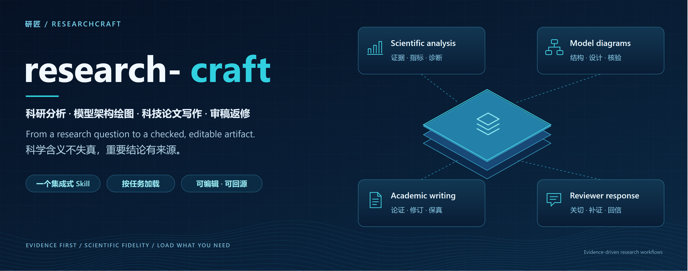
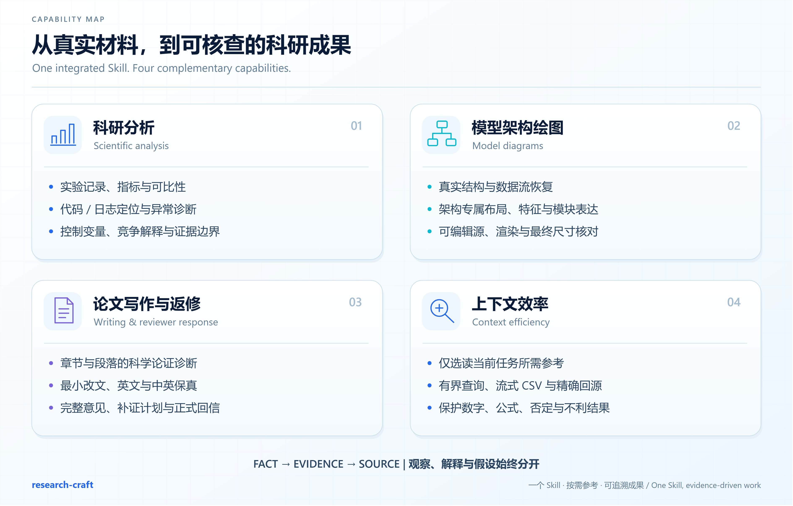
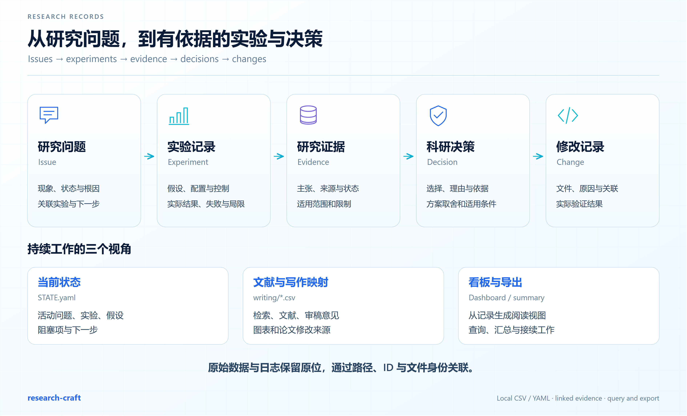
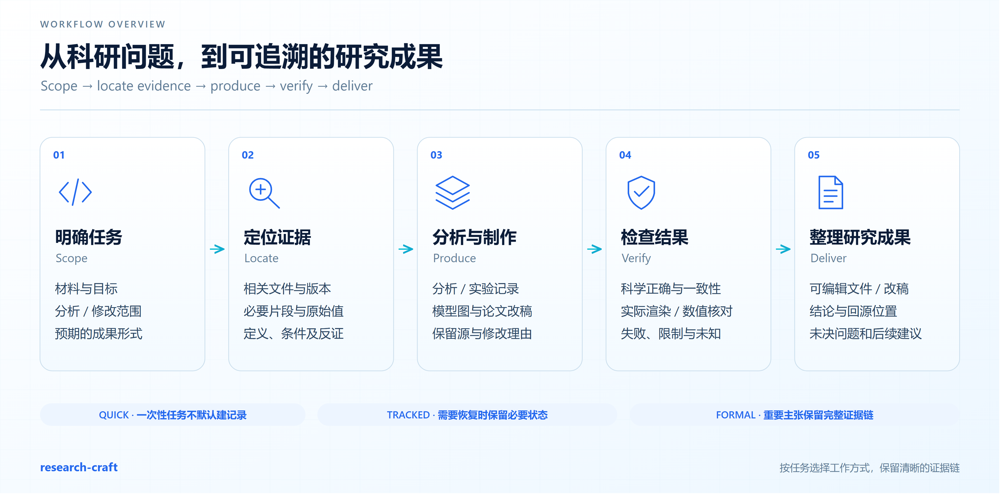
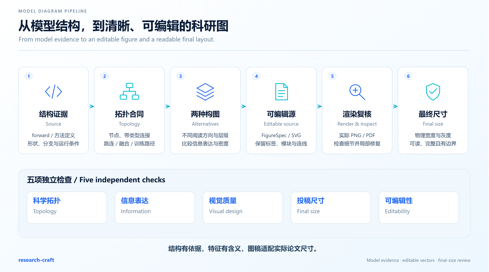
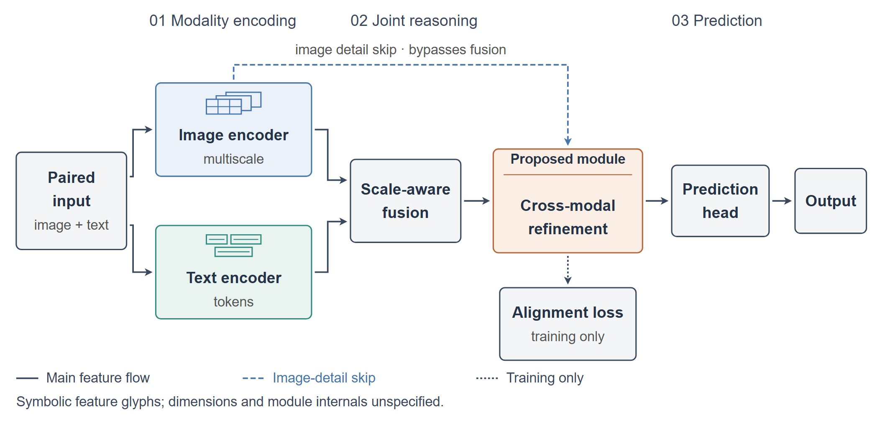
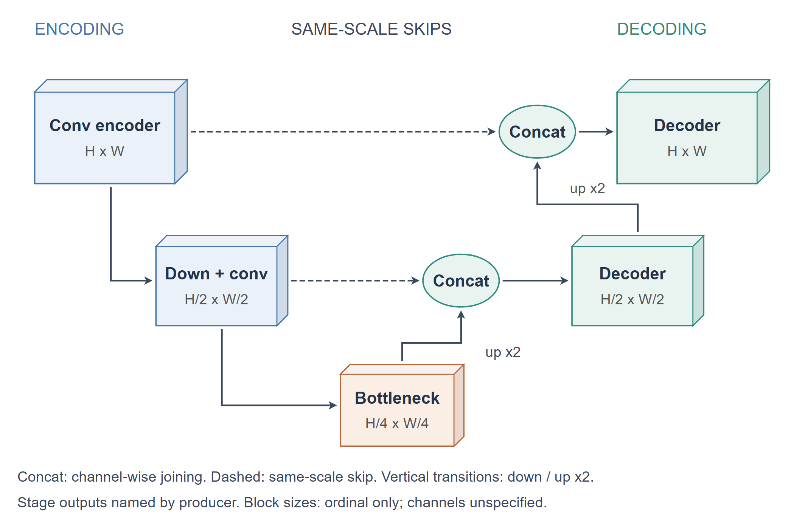
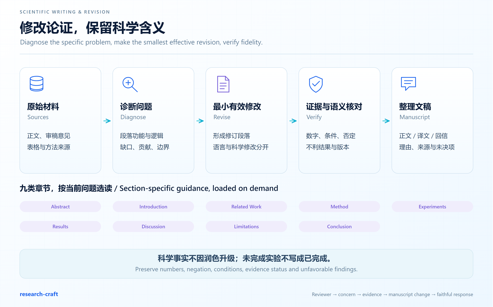
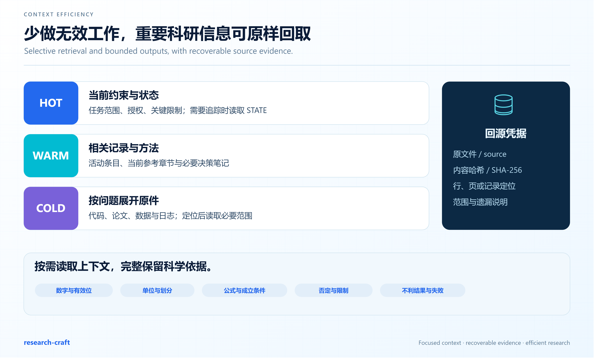

<div align="center">


# ResearchCraft · research-craft

**Evidence-based analysis, traceable experiments and clear scientific communication.**

[中文](README.md) · [Get started](#getting-started) · [Feature guide](research-craft/docs/FEATURES.en.md) · [Research records](research-craft/docs/RECORDS.en.md)
</div>

ResearchCraft is a Codex Skill for literature, code and experiment analysis, research records, editable model diagrams, manuscript revision, translation and reviewer responses. It connects the work to supporting sources so results can be checked and continued.

Install **one Skill** and choose a capability through your request. Invoke `$research-craft` explicitly or describe the research task.

Skill version: `1.3.1-rc.1` (release candidate) · Research workspace schema: `1`



## Features and how to use them

Each guide lists the inputs, a copyable chat prompt and the expected output.

| Capability | Typical use | Guide |
| --- | --- | --- |
| Research and literature | Compare methods, identify primary sources and examine a gap | [Literature](research-craft/docs/FEATURES.en.md#01-research-and-literature) |
| Code and logs | Trace behavior, errors and configuration differences | [Code analysis](research-craft/docs/FEATURES.en.md#02-code-and-logs) |
| Data and metrics | Check outliers, definitions and fair comparisons | [Data checks](research-craft/docs/FEATURES.en.md#03-data-and-metrics) |
| Experiment planning | Select controls, ablations and useful follow-ups | [Planning](research-craft/docs/FEATURES.en.md#04-experiment-planning) |
| Research records | Link issues, experiments, evidence, decisions and changes | [Record management](research-craft/docs/RECORDS.en.md) |
| Model diagrams | Recover topology and make editable paper figures | [Diagram creation](research-craft/docs/FEATURES.en.md#05-model-diagrams) |
| Scientific writing | Diagnose arguments and revise manuscript sections | [Writing](research-craft/docs/FEATURES.en.md#06-scientific-writing) |
| Translation and editing | Improve language with scientific fidelity | [Language work](research-craft/docs/FEATURES.en.md#07-translation-and-editing) |
| Reviewer responses | Map concerns to evidence, revisions and replies | [Revision](research-craft/docs/FEATURES.en.md#08-reviewer-responses) |
| Research guidance | Turn feedback into actionable improvements | [Guidance](research-craft/docs/FEATURES.en.md#09-research-guidance) |
| Resumable tasks | Preserve state and continue longer work | [Task recovery](research-craft/docs/FEATURES.en.md#10-resumable-tasks) |

## Getting started

```bash
git clone https://github.com/mingsong01/research-craft.git
cd research-craft
```

Alternatively, use **Code → Download ZIP**. The root contains documentation; the inner **research-craft/** directory is the installable Skill. Copy that entire directory to `<your-project>/.agents/skills/research-craft/` or `$HOME/.agents/skills/research-craft/`. Preserve `SKILL.md` and its sibling directories. Back up or compare an existing installation first. Older hosts may use `.codex/skills`; follow your host's discovery location. See the [Codex Skills guide](https://learn.chatgpt.com/docs/build-skills).

Linux/macOS personal installation, from the repository root:

```bash
mkdir -p "$HOME/.agents/skills"
test ! -e "$HOME/.agents/skills/research-craft" && \
  cp -R ./research-craft "$HOME/.agents/skills/research-craft"
```

A Windows PowerShell example is in the [Chinese installation guide](research-craft/README.zh-CN.md#安装与开始使用). Reopen the session or refresh Skill discovery after copying.

Use the following in **Codex chat**, replacing paths with your files:

```text
Use $research-craft to analyze logs/train.log and results/metrics.csv.
Explain higher F1 and lower recall after checking the split, threshold
and configuration. Return evidence-linked findings and useful next checks.
```

```text
Use $research-craft to record this experiment. Capture the question,
hypothesis, controls, configuration and result locations. Link the issue,
experiment and evidence, update current state and generate the dashboard.
```

```text
Use $research-craft to diagram models/network.py for a 180 mm paper figure.
Map actual topology, compare two layouts, and deliver editable SVG,
a rendered preview and unresolved structure questions.
```

## Research records and experiment management

The project's `.research/` directory stores open-format records for issues, experiments, evidence, decisions, changes and a chronological journal. Writing maps cover literature, searches, reviewer comments, figures and manuscript traceability. State captures current work, while a generated dashboard provides an overview.



Experiment manifests can describe hypotheses, controls, datasets, splits, seeds, environment, commands, metrics, results, claim boundaries and limitations. Failed experiments remain useful records. Large data and checkpoints can stay in their original location with paths and file identities.

See the [complete record guide](research-craft/docs/RECORDS.en.md) for creation, updates, queries, export and recovery.

## Workflow



QUICK suits one-off questions. TRACKED retains state for continued investigations. FORMAL links consequential experiments and manuscript decisions to plans and evidence. Records are created as needed; plans, completed work, observations and explanations retain distinct status.

## Model diagrams



Start from computation or a method definition, then choose a composition. Encoder–Decoder figures emphasize scales and skips; Transformers emphasize tokens, attention and residuals; SSMs emphasize state and recurrence; multimodal figures distinguish sources and interactions. Complex figures compare layouts and review topology, information, aesthetics, final size and editability separately.

### Examples and editable sources

The following **synthetic architectures** illustrate feature symbols, grouping and connection styles.



[SVG](research-craft/demo/publication/multimodal-A/architecture.svg) · [FigureSpec](research-craft/demo/publication/multimodal-A/figure-spec.json) · [Topology](research-craft/demo/publication/multimodal-A/topology.json)



[SVG](research-craft/demo/publication/unet-multiscale/architecture.svg) · [FigureSpec](research-craft/demo/publication/unet-multiscale/figure-spec.json) · [Topology](research-craft/demo/publication/unet-multiscale/topology.json)

These layouts target 180 mm; 85 mm requires a separate readability review or layout. Real models require comparison with their code. [Known limits](research-craft/PUBLISHING_SNAPSHOT.md)

## Writing, translation and reviewer revision



Section-specific methods cover Abstract through Conclusion, including Related Work, Method, Experiments, Results, Discussion and Limitations. Revisions diagnose the argument, return usable prose and explain changes. Language editing preserves terminology, numbers, units, negation, conditions and claim strength. Scientific corrections are identified separately.

Reviewer work connects comments to concerns, evidence, supplementary work, manuscript changes and a formal reply. Completed and proposed work retain their actual status. See [feature-specific prompts](research-craft/docs/FEATURES.en.md).

## Context and longer tasks



Task-specific reading, bounded queries and streaming summaries reduce unrelated material. File identities and precise locations keep source details recoverable. Important numbers, formula conditions, complete comments and unfavorable findings remain part of the evidence. No general Token-saving percentage has been established.

## Requirements and quality

Use your existing Codex environment. Python helpers use the standard library with a documented target of 3.9+. Some SVG tools use Node.js; optional Chromium export recommends Node 22+. Figure rendering requires an available browser or PDF tool.

`SKILL.md` is the entry point; `references/` contains methods; `scripts/` contains helpers; `assets/` contains templates; `demo/` contains examples; `tests/` and `evals/` contain engineering tests and offline contracts.

The local check record includes **110 tests and 60 offline contracts**, plus fresh archive extraction. These cover implementation and contracts; scientific outputs still need evidence-based review. [Check details](research-craft/RELEASE_CHECKS.md) · [Compatibility](research-craft/PUBLISHING_SNAPSHOT.md)

## Privacy, licensing and contributions

Records are stored locally; model instructions and tool outputs follow the host service's data policies. Check permissions for unpublished materials and use sanitized examples in Issues. [Data handling](research-craft/SECURITY.md)

The original work does not yet have a project-wide license. Third-party components retain their own licenses and attribution. Read [license information](research-craft/LICENSE_STATUS.md) and [third-party notices](research-craft/THIRD_PARTY_NOTICES.md) before reuse or redistribution.

Feedback is welcome. Include the task, sanitized input, expected behavior and actual result so the problem can be reproduced.
